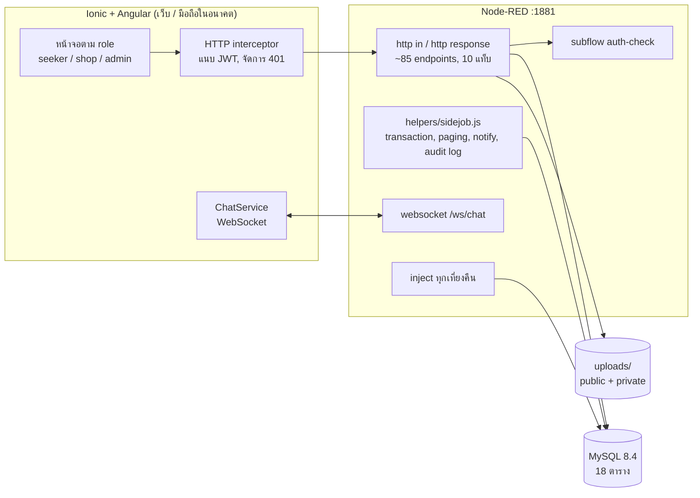
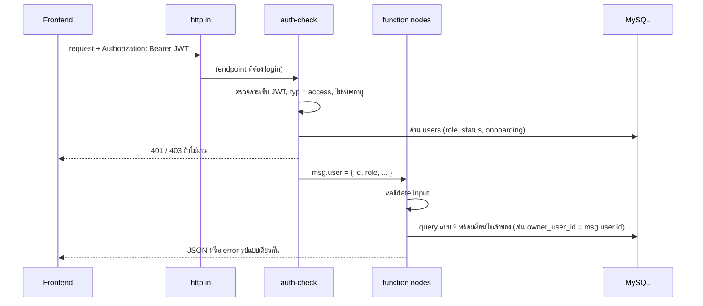
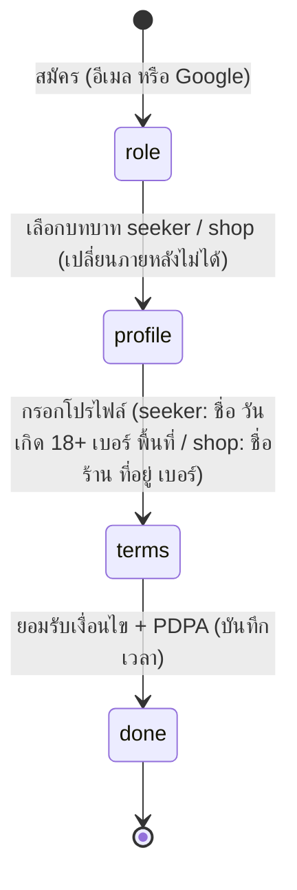
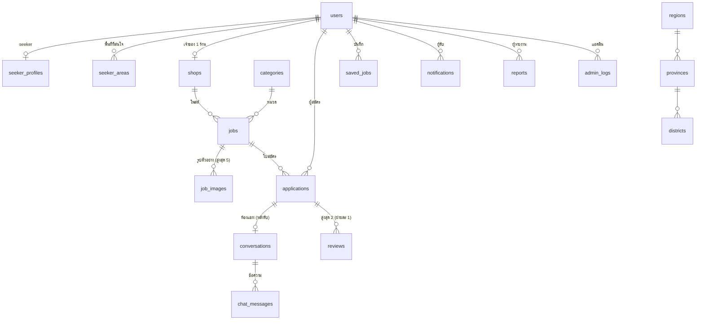
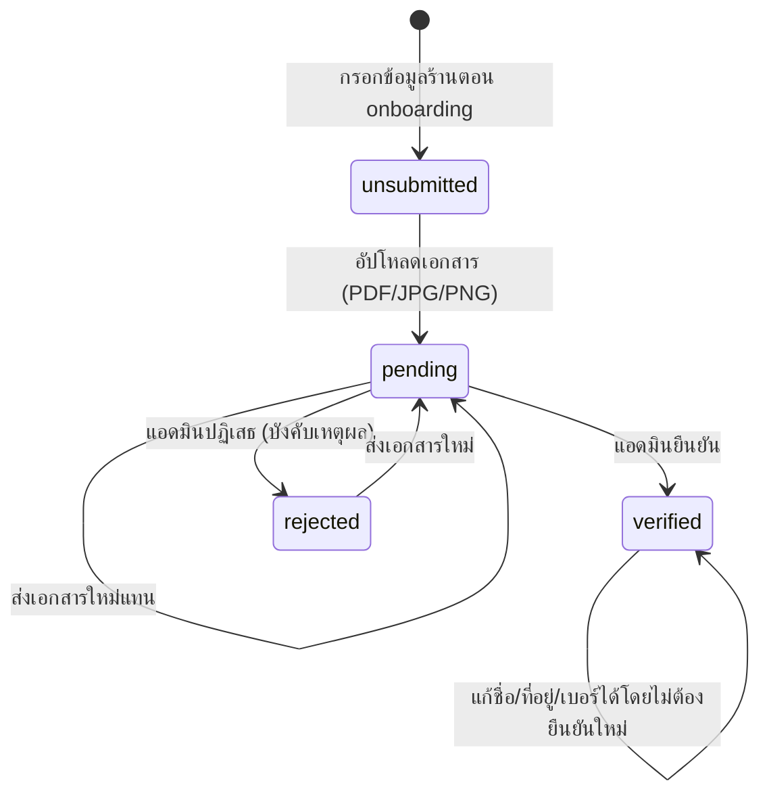
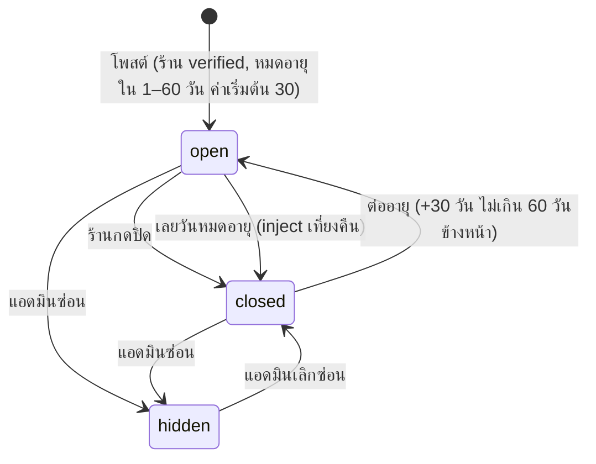
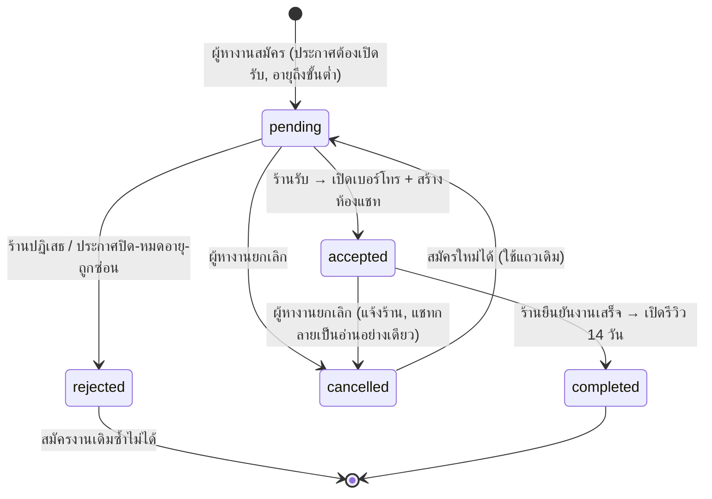
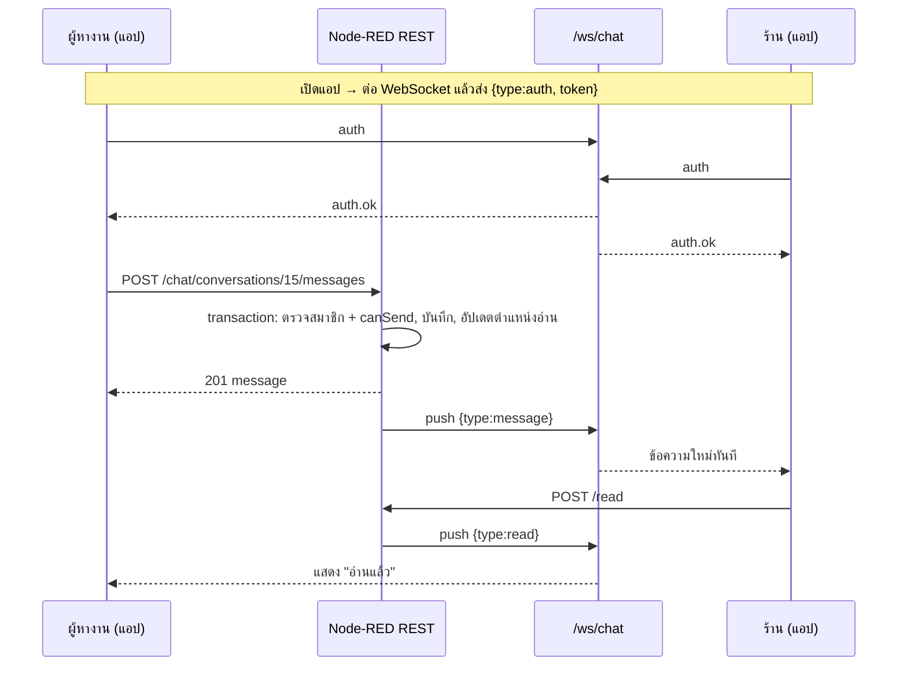

# SideJob — การวิเคราะห์ logic การทำงานของระบบ

เอกสารนี้อธิบายว่าระบบทำงานอย่างไรตั้งแต่ต้นจนจบ: โครงสร้าง, ข้อมูล, สถานะของแต่ละอย่าง, กติกาที่ backend บังคับ,
งานเบื้องหลัง, แชท และจุดที่ควรรู้ก่อนพัฒนาต่อ รายละเอียด request / response ของแต่ละ API อยู่ใน [api.md](api.md)

สถานะ ณ 7 ต.ค. 2569: ทำครบ Phase 0–8 + แชท + ตัด LINE ออก (Phase 9 มือถือยังไม่ทำ)

---

## 1. ภาพรวมสถาปัตยกรรม

| ชั้น | หน้าที่ | ไฟล์หลัก |
|---|---|---|
| Frontend | หน้าจอทั้งหมด แยก lazy-load ตาม role, guard เพื่อ UX เท่านั้น | `frontend/src/app/{seeker,shop,admin,shared}` |
| API | ทุกกติกาและการตรวจสิทธิ์ **อยู่ที่นี่** | `backend/flows.json` |
| Helper | transaction (mysql2 pool), pagination, แจ้งเตือน, audit log, ตรวจไฟล์ | `backend/helpers/sidejob.js` (`global.get('sj')`) |
| ฐานข้อมูล | ข้อมูลทั้งหมด | `database/schema.sql`, `database/migrations/` |
| ไฟล์ | รูป (สาธารณะ) และเอกสารยืนยันร้าน (ส่วนตัว) | `backend/uploads/public`, `backend/uploads/private` |

### แท็บใน Node-RED

| แท็บ | path | endpoint |
|---|---|---|
| Auth | `/api/auth/...` | สมัคร, login, Google, onboarding |
| Seeker | `/api/seeker/...`, `/api/reports` | โปรไฟล์, งานที่บันทึก, ใบสมัคร, รีวิว, รายงาน |
| Shop | `/api/shop/...` | โปรไฟล์ร้าน, เอกสาร, ประกาศ, ผู้สมัคร, แดชบอร์ด, รีวิว |
| Admin | `/api/admin/...` | ร้าน, ผู้ใช้, ประกาศ, รายงาน, หมวดหมู่, audit log, สถิติ |
| Jobs (public) | `/api/jobs/...` | ค้นหา, รายละเอียด, หมวดหมู่, จำนวนงานต่อพื้นที่, รีวิวร้าน |
| Geo | `/api/geo` | ภาค / จังหวัด / อำเภอ |
| Notifications | `/api/notifications/...` | รายการ, จำนวนยังไม่อ่าน, อ่านแล้ว |
| Chat | `/api/chat/...` + `ws /ws/chat` | ห้องแชท, ข้อความ, real-time |
| Scheduled | inject 00:00 | ปิดประกาศหมดอายุ |
| System | `/api/health` | ตรวจสถานะ |

---

## 2. รูปแบบการทำงานของทุก request

หลักที่ใช้ทุก endpoint:

1. **ตรวจสิทธิ์ทุกครั้งจากฐานข้อมูล** — auth-check อ่าน `users` ใหม่ทุก request ถ้าแอดมินระงับบัญชี token เดิมใช้ไม่ได้ทันที
2. **เช็กความเป็นเจ้าของใน WHERE เสมอ** — ร้านเห็น / แก้ได้เฉพาะของร้านตัวเอง ผู้หางานเห็นเฉพาะใบสมัครตัวเอง ถ้าไม่ใช่เจ้าของจะได้ 404 (ไม่บอกว่ามีอยู่จริง)
3. **SQL แบบ `?` เท่านั้น** — ไม่มีการต่อสตริงจาก input ผู้ใช้ (ชื่อคอลัมน์ที่ต้องเลือกจะเลือกจากค่าคงที่ในโค้ด)
4. **error รูปแบบเดียว** `{ error: { code, message } }` ผ่าน catch node ของแต่ละแท็บ ข้อความภาษาไทยพร้อมแสดงผู้ใช้
5. **การกระทำหลายขั้นใช้ transaction** (`sj.tx`) — เช่น รับใบสมัคร = เปลี่ยนสถานะ + สร้างห้องแชท + แจ้งเตือน ถ้าขั้นใดพลาด ย้อนทั้งหมด

---

## 3. ผู้ใช้และการเข้าสู่ระบบ

### Onboarding

- ระหว่างยังไม่ `done` guard จะพากลับหน้า onboarding และ API ส่วนใหญ่ตอบ 403 `PROFILE_INCOMPLETE`
- แอดมินสร้างจาก seed เท่านั้น login ด้วยอีเมล/รหัสผ่านอย่างเดียว
- **Google Sign-In**: backend ตรวจ ID token กับ Google (audience = Client ID) ใช้อีเมลจาก token เท่านั้น
  ถ้าอีเมลซ้ำกับบัญชีที่มีรหัสผ่าน จะขอรหัสผ่านเดิมเพื่อเชื่อมบัญชี (ไม่สร้างซ้ำ)
- รหัสผ่าน hash ด้วย bcrypt, JWT อายุ 7 วัน, ไม่ส่ง hash กลับไป frontend เลย

### สิทธิ์ตาม role

| ทำอะไร | seeker | shop | admin |
|---|:-:|:-:|:-:|
| ค้นหา / ดูประกาศ | ✅ (ไม่ต้อง login ก็ได้) | ✅ | ✅ |
| สมัคร / ยกเลิกใบสมัครตัวเอง | ✅ | | |
| โพสต์ / แก้ / ปิด / ต่ออายุประกาศ | | ✅ ต้อง verified | ซ่อน / เลิกซ่อน |
| รับ / ปฏิเสธ / ยืนยันงานเสร็จ | | ✅ งานตัวเอง | ดูรายชื่อได้ |
| แชท | ✅ หลังถูกรับ | ✅ หลังรับ | |
| รีวิว / รายงาน | ✅ | ✅ | ซ่อนรีวิว / จัดการรายงาน |
| ยืนยันร้าน, ระงับบัญชี, หมวดหมู่, audit log | | | ✅ |

---

## 4. ข้อมูลหลักและความสัมพันธ์

- `users` ใช้ login อย่างเดียว ข้อมูลส่วนตัวอยู่ใน `seeker_profiles` / `shops`
- จังหวัด / อำเภอเก็บเป็น id เสมอ (77 จังหวัด, 930 อำเภอ, จัด 4 ภาค) frontend โหลดครั้งเดียวแล้ว cache
- `reports` ชี้เป้าหมายแบบ polymorphic (`target_type` = job / review) ไม่มี FK ระบบตรวจว่ามีอยู่จริงตอนรายงาน
- `admin_logs` user ของแอปมีสิทธิ์แค่ SELECT / INSERT (แก้ / ลบไม่ได้ในระดับฐานข้อมูล)

---

## 5. สถานะ (state machine) ของแต่ละอย่าง

### 5.1 การยืนยันร้าน

- ยืนยัน / ปฏิเสธ = เปลี่ยนสถานะ + audit log + แจ้งเตือนร้าน ใน transaction เดียว
- เอกสารอยู่ใน `uploads/private` ไม่เปิดสาธารณะ ดูได้ผ่าน API ที่ตรวจ role admin เท่านั้น
- ร้านที่ไม่ใช่ `verified` โพสต์ / ต่ออายุประกาศไม่ได้ (403 `SHOP_NOT_VERIFIED`)

### 5.2 ประกาศงาน

- **ทุกครั้งที่ประกาศหยุดรับ (ปิด / หมดอายุ / ซ่อน)** ใบสมัครที่ยัง `pending` ถูกปฏิเสธอัตโนมัติและแจ้งผู้หางาน ใบที่รับแล้วยังอยู่
- เมื่อมีใบสมัคร (pending / accepted / completed) แล้ว **ล็อกค่าจ้างและวันเวลาทำงาน** แก้ได้เฉพาะช่องอื่น (409 `JOB_LOCKED`)
- ประกาศ `hidden` ร้านแก้ไข / ต่ออายุไม่ได้
- วันทำงานมี 2 แบบ: ทุกสัปดาห์ (เลือกวัน) หรือช่วงวันที่ — แบบช่วงวันที่ระบบเก็บ "วันในสัปดาห์ที่ครอบคลุม" ไว้ด้วย เพื่อให้ตัวกรองวันทำงานใช้ได้ทั้งสองแบบ

### 5.3 ใบสมัคร (หัวใจของระบบ)

สิ่งที่ "เปิด" ตามสถานะ:

| สถานะ | เบอร์โทรอีกฝ่าย | แชท | รีวิว |
|---|---|---|---|
| pending | ❌ | ❌ | ❌ |
| accepted | ✅ | ✅ ส่งได้ | ❌ |
| completed | ✅ | ✅ ส่งได้ | ✅ ภายใน 14 วัน ฝ่ายละครั้ง |
| cancelled (หลังเคยรับ) | ❌ | อ่านได้ ส่งไม่ได้ | ❌ |
| rejected | ❌ | ❌ | ❌ |

เบอร์โทรถูกเลือกส่งกลับจาก backend ตามตารางนี้เท่านั้น (frontend ไม่ได้ซ่อนเอง)

### 5.4 รีวิวและรายงาน

- รีวิวได้เฉพาะใบสมัคร `completed` ภายใน 14 วันนับจากวันยืนยันงานเสร็จ ฝ่ายละ 1 ครั้ง (unique key ในฐานข้อมูล)
- คะแนนเฉลี่ยคำนวณสดจากรีวิวที่ไม่ถูกซ่อน แสดงบนร้าน / ผู้หางาน / ผู้สมัคร / หน้ารายละเอียดงาน
- รายงานได้ทั้งประกาศและรีวิว คนละ 1 ครั้งต่อเป้าหมาย แอดมิน: "ซ่อน + ปิดรายงาน" (ปิดรายงานอื่นของเป้าหมายเดียวกันด้วย), "ปิดโดยไม่ซ่อน", "ยกเลิก"

---

## 6. ค้นหางาน

ประกาศจะแสดงในผลค้นหาเมื่อ **ครบทุกข้อ**: `open` + ยังไม่หมดอายุ + (แบบช่วงวันที่) วันทำงานยังไม่ผ่าน + ร้าน `verified` + เจ้าของร้านไม่ถูกระงับ

- ตัวกรอง: จังหวัด, หลายอำเภอ, หมวด, ช่วงค่าจ้าง + หน่วย, วันทำงาน (bit mask บนคอลัมน์ SET), คำค้น
- เรียงใหม่ → เก่า, แบ่งหน้า 20 รายการ ส่ง `hasNext` (ดึงเกิน 1 แถวเพื่อรู้ว่ามีหน้าถัดไป)
- ผู้หางานเลือกพื้นที่ผ่าน modal ภาค → จังหวัด → อำเภอ (ค้นหาข้ามขั้นได้, เลือกหลายอำเภอ, แสดงจำนวนงาน) จำค่าล่าสุดในเครื่อง
- หน้ารายละเอียดยังเปิดประกาศที่ปิดแล้วได้ (ขึ้น "ปิดรับสมัครแล้ว") เพื่อให้หน้างานที่บันทึกและใบสมัครเปิดได้

---

## 7. แจ้งเตือนและงานเบื้องหลัง

- แจ้งเตือนสร้างผ่าน `sj.notify()` **ใน transaction เดียวกับเหตุการณ์** (ถ้าเหตุการณ์ล้ม แจ้งเตือนก็ไม่ถูกสร้าง)
- ประเภท: ผู้สมัครใหม่, ถูกรับ / ปฏิเสธ, ผู้หางานยกเลิกหลังถูกรับ, งานเสร็จ, ร้านผ่าน / ไม่ผ่านการยืนยัน, ประกาศหมดอายุ, ประกาศถูกซ่อน, ได้รับรีวิว
- กระดิ่งเช็กจำนวนที่ยังไม่อ่าน **เมื่อเปลี่ยนหน้า และทุก 60 วินาที** (polling) แตะแล้วพาไปหน้าที่เกี่ยวข้อง
- **Scheduled (00:00 ทุกวัน)**: หาประกาศ `open` ที่เลยวันหมดอายุ → เปลี่ยนเป็น `closed` → ปฏิเสธใบสมัคร pending → แจ้งร้าน ทั้งหมดใน transaction เดียว
  (แอดมินสั่งรันทันทีได้ที่ `POST /api/admin/jobs/close-expired`)

---

## 8. แชท

- **1 ใบสมัคร = 1 ห้อง** สร้างตอนร้านกดรับ (ใน transaction เดียวกับการรับ) สมาชิกคือผู้หางานกับเจ้าของร้านเท่านั้น
- ส่งข้อความผ่าน REST เสมอ (ตรวจสิทธิ์ / บันทึก / transaction ครบ) WebSocket ใช้ **รับ** อย่างเดียว
- WebSocket รับเฉพาะ origin ของแอป (รายการเดียวกับ CORS) และต้องยืนยันตัวด้วย JWT ก่อนถึงจะได้รับอะไร
- ถ้าหลุด แอปต่อใหม่เอง (1 → 30 วินาที) แล้วดึงข้อความที่พลาดด้วย `?after=` จึงไม่มีข้อความหาย
- ยังไม่อ่าน = ข้อความของอีกฝ่ายที่ใหม่กว่าตำแหน่งอ่านของเรา แสดงเป็นตัวเลขบนแท็บ "แชท"

---

## 9. ไฟล์ที่ผู้ใช้อัปโหลด

| ไฟล์ | ชนิด | ที่เก็บ | ใครเปิดได้ |
|---|---|---|---|
| รูปโปรไฟล์ / รูปร้าน | JPG, PNG ≤ 5 MB | `uploads/public/avatars`, `shops` | ทุกคน |
| รูปตัวอย่างงาน (สูงสุด 5) | JPG, PNG ≤ 5 MB | `uploads/public/jobs` | ทุกคน |
| รูปในแชท | JPG, PNG ≤ 5 MB | `uploads/public/chat` | คนที่ได้ URL (ชื่อสุ่ม 128 บิต ส่งให้เฉพาะสมาชิกห้อง) |
| เอกสารยืนยันร้าน | PDF, JPG, PNG ≤ 5 MB | `uploads/private/verify` | แอดมินผ่าน API เท่านั้น |

- ตรวจชนิดไฟล์จาก **signature ของไฟล์จริง** ไม่เชื่อนามสกุล / mimetype ที่ส่งมา
- ตั้งชื่อใหม่แบบสุ่มเสมอ เปลี่ยนรูปใหม่แล้วไฟล์เก่าถูกลบ

---

## 10. ข้อสังเกตและจุดที่ควรรู้ก่อนพัฒนาต่อ

### จุดแข็ง
- กติกาสำคัญทั้งหมดบังคับที่ backend (สิทธิ์, เจ้าของ, สถานะ, การเปิดเบอร์โทร / แชท) frontend แค่สะท้อน
- การกระทำหลายขั้นเป็น transaction ทั้งหมด ไม่มีสถานะครึ่ง ๆ กลาง ๆ
- มี API test 491 checks ครอบคลุมทุก role และกรณีผิดสิทธิ์ (`bash tests/api/run-all.sh`)

### ข้อจำกัด / ความเสี่ยง
| เรื่อง | รายละเอียด | ผลกระทบ | ทางแก้ในอนาคต |
|---|---|---|---|
| WebSocket เก็บรายชื่อ socket ในหน่วยความจำของ Node-RED | ใช้ได้กับเซิร์ฟเวอร์ตัวเดียว รีสตาร์ตแล้วแอปจะต่อใหม่เอง | ขยายเป็นหลายเครื่องไม่ได้ทันที | ใช้ Redis pub/sub |
| รูปในแชทอยู่โฟลเดอร์สาธารณะ | ป้องกันด้วยชื่อสุ่มที่เดาไม่ได้ ไม่ได้ตรวจสิทธิ์ตอนเปิดไฟล์ | ถ้า URL หลุด คนอื่นเปิดได้ | ทำ signed URL หมดอายุ |
| JWT อายุ 7 วัน ไม่มี logout ฝั่งเซิร์ฟเวอร์ | ระงับบัญชีมีผลทันที แต่ token ที่ถูกขโมยใช้ได้จนหมดอายุ | ความเสี่ยงต่ำถึงกลาง | refresh token + revoke list |
| แจ้งเตือนใช้ polling 60 วินาที | ไม่ใช่ real-time (แชทเป็น real-time แล้ว) | ช้าได้ถึง 1 นาที | ส่งแจ้งเตือนผ่าน WebSocket เดียวกัน / FCM |
| ยังไม่มีลืมรหัสผ่าน / ลบบัญชี | ต้องมีก่อนใช้งานจริง (PDPA) | ผู้ใช้ติดต่อแอดมินเอง | เพิ่มระบบอีเมล |
| `flows.json` สร้างจากตัวช่วยสร้าง (generator) นอก repo | แก้ใน Node-RED editor ได้ปกติ แต่ไฟล์ใหญ่ (600+ node) | review diff ยาก | แยก flow เป็นหลายไฟล์ / project mode |
| Sass ใช้ตัวคอมไพล์แบบ JavaScript | Windows Smart App Control บล็อก `dart.exe` | build ช้ากว่าเล็กน้อย | — |

### ลำดับการทำงานทั้งระบบแบบสั้น ๆ
1. ร้านสมัคร → ส่งเอกสาร → แอดมินยืนยัน
2. ร้านโพสต์ประกาศ (มีวันหมดอายุ) → ระบบปิดเองเมื่อครบกำหนด
3. ผู้หางานเลือกพื้นที่ → ค้นหา → สมัคร
4. ร้านรับ → เปิดเบอร์โทร + ห้องแชท → คุยรายละเอียด
5. ร้านยืนยันงานเสร็จ → ทั้งสองฝ่ายรีวิวกันภายใน 14 วัน
6. ทุกขั้นมีแจ้งเตือน ถ้ามีปัญหาผู้ใช้รายงาน → แอดมินจัดการ และทุกการกระทำของแอดมินบันทึก audit log
